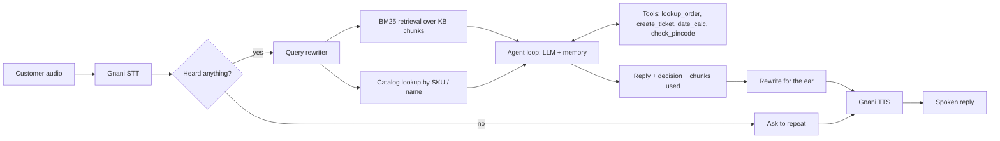

<div align="center">

# 🎙️ ZentroMart VoiceOps

**A customer-support agent you can actually call.**
RAG over company policies · multi-turn memory · verified order lookups · human handover · Indian-language voice via Gnani.

[](https://www.python.org/)
[](LICENSE)
[](https://docs.gnani.ai)
[](https://github.com/YOUR_USERNAME/zentromart-voiceops/actions)
[](https://colab.research.google.com/github/YOUR_USERNAME/zentromart-voiceops/blob/main/notebooks/VoiceOps_Colab.ipynb)

</div>

> Built for the **VoiceOps 2026** capstone (LLM & GenAI course, Consulting & Analytics Club IIT Guwahati × Gnani.ai).
> The store, customers and orders are **synthetic**. The dataset is supplied by the organisers and is not included here.

```
customer audio ─► Gnani STT ─► agent (LLM + RAG + tools + memory) ─► Gnani TTS ─► spoken reply
```

## ✨ What it does

| | |
| --- | --- |
| 📚 **Grounded answers** | Answers only from the policy documents. If the documents do not cover it, it says so instead of inventing a policy, date or amount. |
| 🔎 **Smart retrieval** | BM25 over section-level chunks, with document precedence (policy > agent guide > help > FAQ > marketing) and superseded policies excluded. Hindi / Hinglish / follow-up messages are rewritten into a clean English search query first. |
| 💬 **Real conversations** | Remembers the order ID and the problem, understands "how long will *that* take?", asks one clear question when something is missing. |
| 🔐 **Caller verification** | Order details are revealed only after the caller matches the last 4 phone digits or the delivery pincode. |
| 🧑‍💼 **Honest handover** | Refuses policy-breaking requests politely and hands over to a human only when a ticket was *really* created. |
| 🗣️ **Voice, end to end** | Gnani STT in, Gnani TTS out. Unclear audio gets a polite retry. Replies are rewritten for the ear (order IDs in groups, "49 rupees"). English, Hindi, Hinglish and 8 more Indian languages. |

### First turn of a real session

```
you > hello my order not received
bot > Namaste, I am ZentroMart's AI support assistant. To help you check your delivery,
      could you please tell me your order ID?
      [clarify]  chunks: STY-1, TRK-2, KB-00.1
```

Every reply reports the decision (`answer | clarify | refuse | escalate`), the chunk IDs it used and the tools it called.

## 🧠 Architecture



## 🛡️ Safety is enforced in code, not just in the prompt

* Order data reaches the LLM only **after** `lookup_order` verified the caller. The delivery pincode itself is never shown to the LLM, and only one retry is allowed per order.
* Verification values are masked in logs and stripped from ticket summaries.
* A handover is reported only when `create_ticket` returned `created=True`. If the model says "escalate" without a ticket, the code creates one first.
* Dates and business days come from a calendar tool (Mon–Sat, `holidays.csv`, "today" = 20 Oct 2026), not from the model's arithmetic.
* Nothing is hard-coded per question: every answer comes from the documents and the data tables.

## 🚀 Quick start

```bash
git clone https://github.com/YOUR_USERNAME/zentromart-voiceops.git
cd zentromart-voiceops
python -m pip install -r requirements.txt
cp .env.example .env          # then fill in your keys and DATASET_DIR
python run.py doctor          # checks keys, dataset, packages, a real LLM call and Gnani
```

You need:

1. The dataset zip from the organisers, extracted anywhere. Set `DATASET_DIR` to the folder that contains `kb/`, `data/` and `tools/`.
2. An LLM key. Gemini (via its OpenAI-compatible API), OpenAI and Anthropic are supported; see `.env.example`.
3. A Gnani key from [app.gnani.ai/voice](https://app.gnani.ai/voice). One key covers STT and TTS.

Windows: `setup.bat`. Linux / macOS: `./setup.sh`.

**No local setup?** Click the *Open in Colab* badge. The notebook asks for your keys with a hidden prompt and never stores them.

## 🕹️ Commands

| What | Command |
| --- | --- |
| Check everything at once | `python run.py doctor` |
| Chat by typing | `python run.py chat` |
| Talk with your microphone (`pip install sounddevice`) | `python run.py voice` |
| **Batch run**: folder of customer audio in, text + audio + chunks out | `python run.py batch --audio_dir path/to/audio --out sample_outputs` |
| Score Step 1 vs Step 2 vs Step 3 | `python run.py eval` (try `--limit 5`, `--asr`, `--pause 2`) |

`batch` writes, for each audio file: `<name>.json` (what was heard, reply, decision, retrieved and used chunk IDs, tool calls), `<name>_reply.txt`, `<name>_reply.wav`, plus one `results.csv`. Each file is a new customer; add `--sequential` to treat the folder as one conversation in file-name order.

## 📊 Results

Measured on the 52 practice questions and 23 practice conversations with `python run.py eval`. Per-row details are saved to `sample_outputs/eval_*.csv`.

| Step | What changes | Result |
| --- | --- | --- |
| 1. LLM only | System prompt, no documents | `__ / 52` |
| 2. + RAG | BM25 retrieval, answer only from chunks | `__ / 52` (retrieval recall `__`) |
| 3. + Conversation | Memory, tools, verification, handover | `__ / 96` turns |

## 🧩 How it is built

| Step | File | What it does |
| --- | --- | --- |
| 1. LLM | `src/llm.py`, `src/agent.py` | One wrapper for Anthropic or any OpenAI-compatible API. Baseline mode is system prompt only. |
| 2. RAG | `src/kb.py` | Chunks each `kb/*.md` by `[SECTION-ID]`, keeps `status` and `effective_from`, BM25 index with document-type precedence. Catalog rows are added when a SKU or product name is mentioned, even if speech-to-text spelled the SKU out. |
| 3. Conversation | `src/agent.py`, `src/tools_layer.py` | Memory plus a small JSON action loop over the tools. |
| 4. Voice | `src/voice.py` | Gnani STT (long WAV files are cut into 55 s pieces), polite recovery on unclear audio, TTS language follows the reply language. |

```
run.py            doctor | chat | voice | batch | eval
src/              config.py  llm.py  kb.py  tools_layer.py  agent.py  voice.py  evaluate.py
tests/            test_offline.py  retrieval_check.py
notebooks/        VoiceOps_Colab.ipynb
sample_outputs/   created by batch / eval
```

## ✅ Tests

```bash
DATASET_DIR=/path/to/Capstone_Project_Dataset_FTTT_2026 python tests/test_offline.py
```

Runs offline with a fake LLM: verification and retry limit, ticket redaction, date rules, ASR clean-up, conversation memory and the scoring helpers.

## 🔭 Ideas for next

* Dense or hybrid retrieval with a reranker on top of BM25.
* Streaming STT/TTS for lower latency on live calls.
* A small web UI with push-to-talk.

## 🙏 Acknowledgements

Consulting & Analytics Club, IIT Guwahati and Gnani.ai for the brief, the synthetic dataset and the speech models.

## 📄 License

[MIT](LICENSE). Keep secrets in `.env` (git-ignored). Never commit keys or the dataset.

---
<div align="center">If this helped you, a ⭐ is much appreciated.</div>
